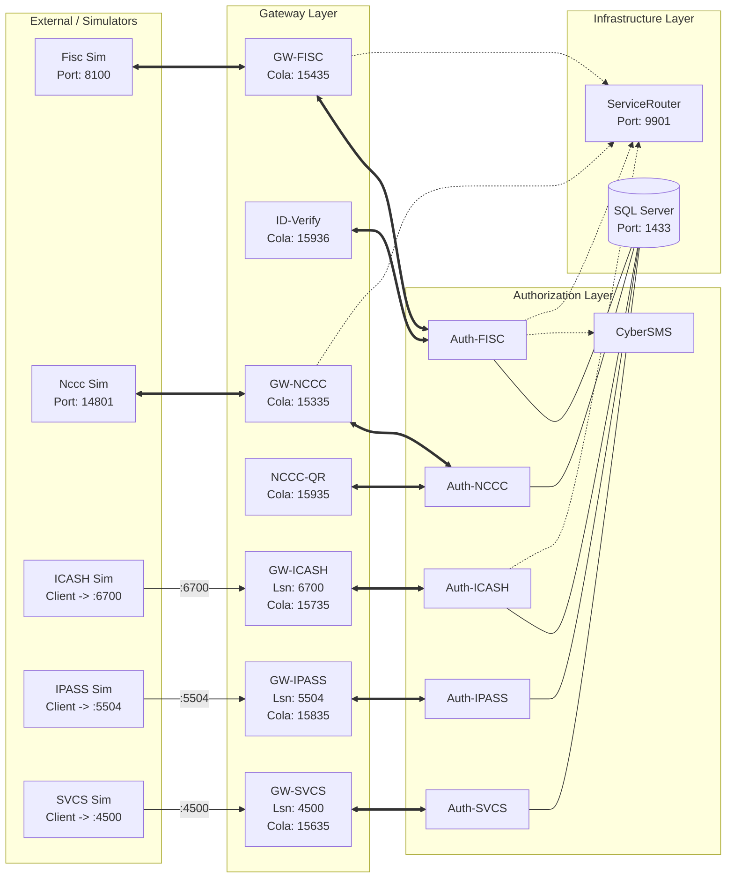
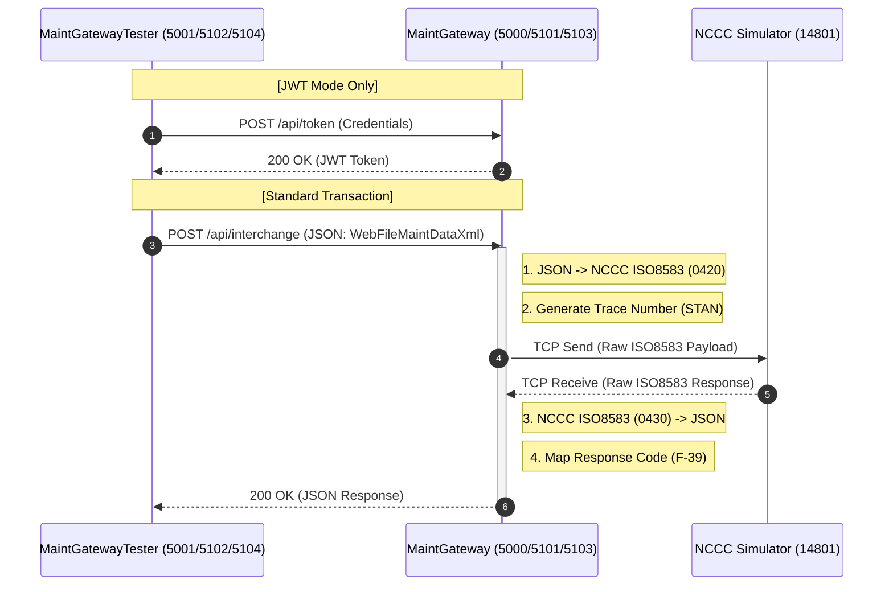

# CyberCOLA .NET 10 Transaction & Tool Flow

此文件詳細描述了全系統核心交易流向與 `tools/` 腳本的執行邏輯。

---

## 1. 系統架構流向 (BFD)

---

## 2. 核心埠號配置總結 (Node 1 / Node 2 Active-Active)

| 系統模組 | 外部監聽埠 (Listen) | 內部通訊埠 (Cola) | Auth 起始埠 (Local) |
| :--- | :--- | :--- | :--- |
| **FISC (Node 1)** | 8100 (Client Mode) | 15435 | 25100 |
| **FISC (Node 2)** | 8200 (Client Mode) | 15436 | 26100 |
| **NCCC (Node 1)** | 14801 (Client Mode) | 15335 | 25000 |
| **NCCC (Node 2)** | 15801 (Client Mode) | 15336 | 26000 |
| **ICASH (Node 1)** | 6700 | 15735 | 25400 |
| **ICASH (Node 2)** | 15736 | 15736 | 26400 |
| **IPASS (Node 1)** | 5504 | 15835 | 25500 |
| **IPASS (Node 2)** | 15836 | 15836 | 26500 |
| **SVCS (Node 1)** | 4500 | 15635 | 25300 |
| **SVCS (Node 2)** | 15636 | 15636 | 26300 |
| **MaintGW (HTTP)** | 5000 | - | 5001 (Tester) |
| **MaintGW (HTTPS)**| 5101 | - | 5102 (Tester) |
| **MaintGW (JWT)**  | 5103 (HTTPS) | - | 5104 (Tester) |
| **ServiceRouter**| 9901 / 9902 | - | - |

---

## 3. 整合測試啟動鏈 (COLATestFlowMenu.ps1)

1.  **環境預檢**: 執行資料庫連線與埠號排除預檢，確保無 Hyper-V 排他埠衝突。
2.  **階段一：模擬器**: 啟動對應模組的 WPF 模擬器 (或 Web Kestrel 模擬器，於對應的 `publish/cross-platform` 目錄啟動)。
3.  **階段二：網關**: 啟動 GW 進程（例如 `CyberGWICASH`）。如果是電子票證，GW 會開始監聽外部埠（如 6700/15736）。
4.  **階段三：驗證服務**: 啟動 Auth 服務並連向 GW 的內部 Cola 埠。支援雙節點 (Node 1 / Node 2) Active-Active 同時執行與負載分流。
5.  **報表**: 執行 TCP 掃描並顯示所有關鍵埠號在雙節點上的 Established 連線數與服務狀態矩陣。

---

## 4. 維護網關交易流向 (MaintGateway Flow)

此架構描述了基於 WebAPI 的檔案維護（MaintGateway）交易處理流程，包含 JSON 與 ISO8583 之間的協定轉換。

---
*Last Updated: 2026-07-24 (Added Node 2 Active-Active ports, Web cross-platform paths, and aligned system health check)*

