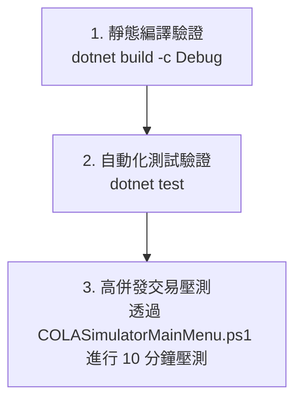

# CyberCOLA .NET 10 - 原始碼非同步重構分階段執行計畫

> [!NOTE]
> **當前狀態 (2026-07-24)**: 所有重構階段 (階段一、二、三) 與所有優先級優化 (優先級 A、B、C) 均已全部實施完成、通過編譯 (0 警告, 0 錯誤) 並已成功推送至 `master` 分支。

為了確保非同步重構（將 `Thread.Sleep` 替換為 `await Task.Delay`，以及消除 `.Result` 阻塞）在 100% 不破壞現有金融交易流程的前提下安全實施，我們建議採取 **分階段（Phased Approach）** 的實施與驗證步驟：

---

## 階段一：背景輪詢與監控服務重構 (100% 安全)

此階段聚焦於系統背景監控、狀態輪詢等不參與主交易流程的執行緒，風險極低，重構後能立竿見影地釋放閒置執行緒池資源。

### 1. 實施標的
- **背景進程監控** (`src\CyberCOLA\WebMonitorService\MonitorServiceManager.cs` - 第 227 行)
- **TCP 用戶端通訊監控** (`src\CyberCOLA\WebTCPClientService\TCPClientServiceManager.cs` - 第 191 行)
- **TCP 路由用戶端** (`src\CyberCOLA\WebTCPClientAuthRouterClient\TCPClientAuthRouterManager.cs` - 第 208 行)

### 2. 重構方法 (範例)
將原有的同步循環方法修改為非同步方法：
```diff
- private void StartMonitoringLoop() {
-     while (!_stopRequested) {
-         CheckStatus();
-         Thread.Sleep(1000);
-     }
- }
+ private async Task StartMonitoringLoopAsync(CancellationToken cancellationToken) {
+     while (!cancellationToken.IsCancellationRequested) {
+         CheckStatus();
+         await Task.Delay(1000, cancellationToken);
+     }
+ }
```

---

## 階段二：WPF 模擬器 UI 執行緒解凍 (介面流暢度優化)

重構 WPF 模擬器中的等待邏輯，確保在高併發壓力測試下，模擬器的桌面視窗介面不會產生短暫凍結或卡死。

### 1. 實施標的
- **用戶端模擬器** (`src\CyberCOLA\WpfClientSimulator\MainWindow.xaml.cs`)
- **電子票證模擬器** (`src\CyberCOLA\WpfETicketClientSimulator\MainWindow.xaml.cs`)
- **智慧卡模擬器** (`src\CyberCOLA\WpfSVCSClientSimulator\MainWindow.xaml.cs`)

### 2. 驗證機制
- 啟動 WPF 模擬器，於介面上設定高頻率交易，驗證拖動視窗與點擊按鈕時完全無卡頓（卡死）現象。

---

## 階段三：核心交易輔助任務 (IDVerify & QRCode 驗證)

此階段處理與測試流程或輔助驗證相關的 Task，需在編譯期進行嚴格把關。

### 1. 實施標的
- **FISC 身分驗證模擬器** (`src\CyberCOLA\ServiceProvider\ClientAuth\CyberAuthFISCIDVerify.cs` - 第 130 行 / 第 638 行)
- **NCCC QRCode 驗證模擬器** (`src\CyberCOLA\ServiceProvider\ClientAuth\CyberAuthNCCCQRCode.cs` - 第 130 行 / 第 628 行)

### 2. 防範安全機制
- **防範 `lock` 語法衝突**：修改前確認目標代碼不位於 `lock (xxx)` 內部。若是，則維持 `Thread.Sleep` 不變，或是重構為 `SemaphoreSlim`。
- **編譯審查**：修改後執行方案編譯，若出現 C# `CS1996`（`lock` 內不能使用 `await`）錯誤，編譯器會自動攔截，保證不會將錯誤代碼帶入執行期。

---

## 階段驗證與測試流程

對於每一個階段的修改，均需強制執行以下「三步驗證法」：



- **Rollback 備案**：所有修改皆在 Git 控制下進行。若於壓測中發現交易流程時序有不可預期之偏差，可隨時透過 `git restore` 進行秒級版本回滾，安全無虞。
