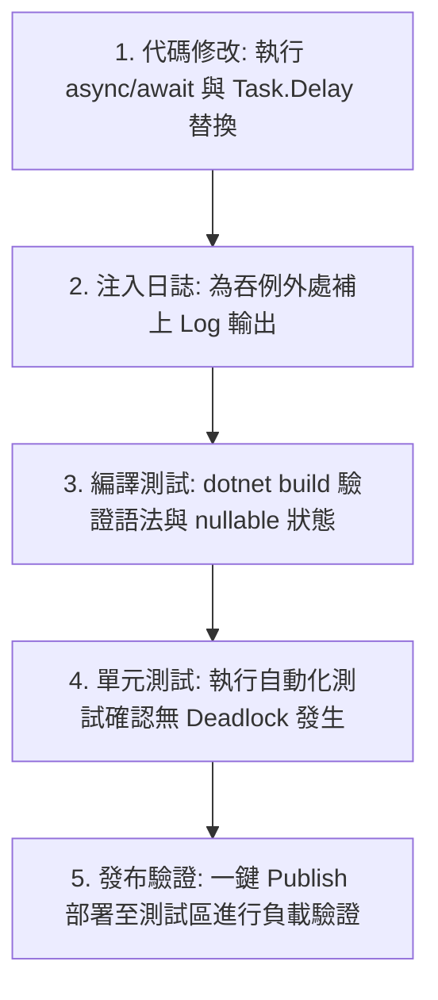

# CyberCOLA .NET 10 系統 - 原始碼品質重構與優化計畫書

本計畫書根據對方案內 **1,319** 個 C# 原始碼檔案的靜態掃描與分析結果，針對排查出的代碼壞味道（Code Smells）提出系統性的重構規劃。主要著重於非同步效能優化、消除執行緒阻塞、安全異常處理以及組態解耦。

---

## 1. 核心重構目標與技術取捨

| 重構類型 | 現存 Code Smell 現象 | 潛在風險與效能衝擊 | 重構方案與最佳實踐 |
| :--- | :--- | :--- | :--- |
| **非同步執行緒阻塞** | 於 Task/Async 方法中使用 `.Result` 或 `.Wait()` 強行獲取非同步產物。 | 會造成執行緒池飢餓（Thread Pool Starvation），在高併發下引發死結（Deadlock）與凍結。 | 將方法鏈路全面重構為 `async/await`，以非同步等待釋放執行緒。 |
| **非同步執行緒凍結** | 在 Task 或 Async 上下文中使用 `Thread.Sleep()` 進行等待。 | 凍結實體執行緒，阻礙非同步 I/O 對象的資源回收，吞吐量急遽下降。 | 將其替換為 **`await Task.Delay()`**，使執行緒在等待期能回到池中處理交易。 |
| **吞例外狀況 (Swallow)**| 空的 `catch { }` 區塊，無任何日誌輸出或重新拋出 (rethrow) 處理。 | 徹底隱蔽系統底層異常，使線上環境的網路中斷或組態錯誤極難調試與排查。 | 統一使用 NLog 記錄錯誤 `_logger.Error(ex)`，或標記為安全例外並加以註明。 |
| **硬編碼 IP/Host** | 原始碼中硬編碼 `"127.0.0.1"` 或 `"localhost"` 作為通訊端點 fallback。 | 失去多主機部署與多節點 Active-Active 拓撲環境的組態彈性。 | 統一收納至 `appsettings.json` 或 `SystemParameterInfo.xml` 中動態讀取。 |

---

## 2. 重構實施細節與檔案清單

### 優先級 A：消除 Thread.Sleep 阻塞 (執行緒資源凍結修復)
在非同步交易與監控輪詢的上下文中，將 `Thread.Sleep` 重構為非阻塞的 `Task.Delay`：

1.  **FISC 驗證服務端** (`src\CyberCOLA\ServiceProvider\ClientAuth\CyberAuthFISCIDVerify.cs`)
    - **位置**：第 130 行 與 第 638 行 `Thread.Sleep(_sleepWaitingMilliseconds);`
    - **重構法**：將方法改為 `async Task`，使用 `await Task.Delay(_sleepWaitingMilliseconds);` 進行非阻塞等待。
2.  **NCCC QRCode 服務端** (`src\CyberCOLA\ServiceProvider\ClientAuth\CyberAuthNCCCQRCode.cs`)
    - **位置**：第 130 行 與 第 628 行
    - **重構法**：同上，轉換為 `await Task.Delay`，提高雙節點併發交易的反應時間。
3.  **即時監控背景服務** (`src\CyberCOLA\WebMonitorService\MonitorServiceManager.cs`)
    - **位置**：第 227 行 `Thread.Sleep(1000);` 位於背景輪詢任務中。
    - **重構法**：重構為 `await Task.Delay(1000, cancellationToken);`，以支援平滑退出與零執行緒阻塞。

### 優先級 B：非同步鏈路解耦 (Result/Wait 消除)
消除會導致執行緒卡死的阻斷性呼叫：

1.  **簡訊通訊元件** (`src\CyberCOLA\CommonLib\SMS\SMSCommUtility.cs`)
    - **位置**：第 255 行 `var sendSMSResult = sendSMS.Result;`
    - **風險**：簡訊服務若發生網路延遲，該阻斷呼叫會直接卡死當前主交易執行緒。
    - **重構法**：重構為 `var sendSMSResult = await sendSMS;`
2.  **Web 模擬器接收引擎** (`src\CyberCOLA\WebServerSimulator\ServerSimulatorManager.cs`)
    - **位置**：第 180 行 `var result = receiveTask.Result;`
    - **重構法**：重構為 `var result = await receiveTask;` 避免阻礙 Kestrel 執行緒池。

### 優先級 C：異常安全防禦 (吞例外狀況補正)
為隱藏的 Exception 區塊補上診斷日誌，或規範其行為：

1.  **EAI 通訊偵聽器** (`src\CyberCOLA\CommonLib\EAI\EAISocketListener.cs`)
    - **位置**：第 389 行 `catch { }`
    - **重構法**：注入 NLog 日誌記錄，至少輸出 `LogManager.GetCurrentClassLogger().Warn(ex, "EAI Socket accept error")`。
2.  **Web 壓力模擬器** (`src\CyberCOLA\WebStressSimulator\StressSimulatorManager.cs`)
    - **位置**：第 332 行 與 第 477 行 `catch { }`
    - **重構法**：捕捉具體異常（如 `SocketException`），並於 UI 儀表板上輸出警告。

---

## 3. 專案重構實施步驟與驗證機制

1.  **修改期**：利用自動化或手動修改，替換 `Thread.Sleep` 及 `.Result`。
2.  **編譯期**：確保在 Nullable 啟用與 ImplicitUsings 環境下編譯無警告（0 Warnings）。
3.  **壓測驗證期**：使用 `COLASimulatorMainMenu.ps1` 開啟高併發 Web 壓力模擬器，連續壓測 10 分鐘，驗證非同步重構後 CPU 使用率下降與 Thread Pool 無飢餓現象。
