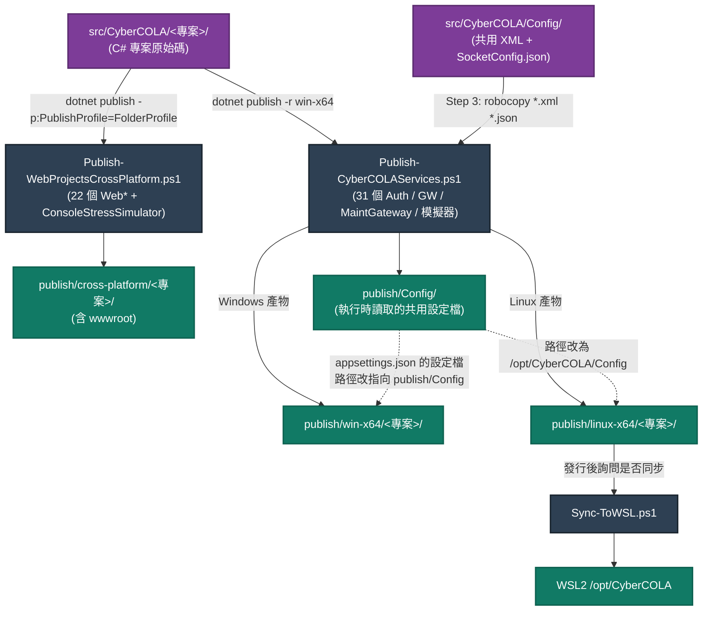

# CyberCOLA .NET 10 - 發行（Publish）資料流向圖

本文件以 Mermaid 流程圖描繪兩支發行腳本如何把原始碼（`src/`）與設定檔編譯、封裝到發行目錄（`publish/`），以及發行後對設定檔所做的修正。

> 第一次使用、想依情境挑選工具，請先看 [`tools/README.md`](../tools/README.md)；所有 script 的呼叫關係圖與詳細說明請見 [`docs/tools_scripts_guide.md`](tools_scripts_guide.md)；各類專案的實際輸出路徑請見 [`docs/RELEASE_MAPPING_GUIDE.md`](RELEASE_MAPPING_GUIDE.md)。

---

## 發行資料流向圖

---

## Publish-CyberCOLAServices.ps1 的處理步驟

| 步驟 | 內容 |
| :--- | :--- |
| 發行前 | `src/` 或 `libs/` 有未 commit 的修改時列出並詢問是否繼續（預設否）；DLL 的 ProductVersion（`1.0.0+<sha>`）只記錄 commit。 |
| Step 2 | 每個專案先停止同名執行中程序、刪除舊輸出目錄，再 `dotnet publish -c Release -r <runtime> --self-contained false`（不含偵錯符號）；`*Tester*` 專案另複製 `TestData`；`NLog.config` 的 log 目錄改為集中 log 根目錄（Linux 為 `/opt/CyberCOLA/LogFiles`）。 |
| Step 3 | 以 robocopy 把 `src/CyberCOLA/Config` 的 `*.xml`、`*.json` 同步到 `publish/Config`（robocopy 回傳 ≥ 8 視為失敗）。 |
| Step 3b | 把 `SocketConfig.json` 的連線設定寫入 `publish/<runtime>` 下各 Auth / GW 的 `appsettings.json`。 |
| Step 4 | 把 `appsettings.json` 中指向 `src/CyberCOLA/Config` 的路徑改為 `publish/Config`，Tester 的 `TestData` 路徑改為發行目錄內的副本。 |
| Step 4b | 僅 `linux-x64`：`*-xml-file-path` 改為 `-LinuxDeployBasePath`（預設 `/opt/CyberCOLA`）下的路徑。 |
| 結束 | 有失敗回傳 exit code `1`，否則 `0`；`linux-x64` 發行成功後詢問是否執行 `Sync-ToWSL.ps1`。 |

## Publish-WebProjectsCrossPlatform.ps1 的處理步驟

| 步驟 | 內容 |
| :--- | :--- |
| 發行 | 對 `src/CyberCOLA` 下所有 `Web*` 專案與 `ConsoleStressSimulator` 執行 `dotnet publish -c Release -p:PublishProfile=FolderProfile -o publish/cross-platform/<專案>`；目標 runtime 依各專案 `FolderProfile.pubxml` 設定。 |
| 靜態資源 | 原始碼有 `wwwroot` 但輸出沒有時，補複製 `wwwroot`。 |
| 設定檔 | 不同步 `publish/Config`，也不改寫 `appsettings.json` 的路徑。 |

> `Enforce-PublishProfilesCRLF.ps1` 是獨立工具（不會被發行腳本呼叫），用來把各 `Web*` 專案的 `FolderProfile.pubxml` 統一為 `<Platform>x64</Platform>` 與 CRLF 換行。
