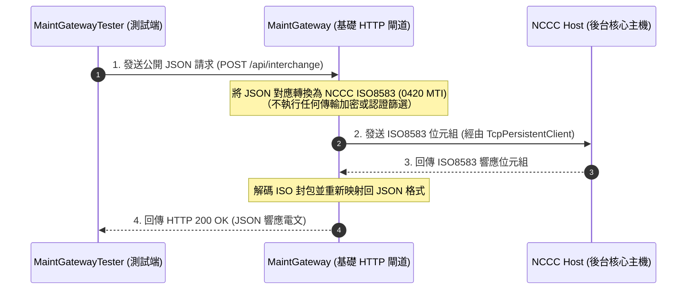
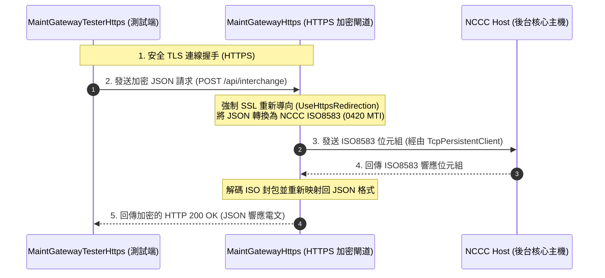
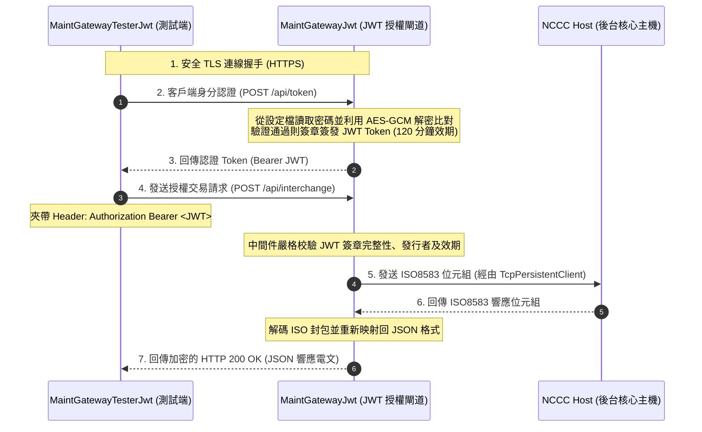

# MaintGateway 家族（基礎版、HTTPS版與JWT版）系統架構與流程指南

> [!NOTE]
> 本文件詳細說明 CyberCOLA 系統中 **MaintGateway\***（維護閘道）系列服務的系統架構、交易程序流程以及安全性協定，涵蓋 **MaintGateway (基礎版)**、**MaintGatewayHttps (HTTPS版)** 與 **MaintGatewayJwt (JWT版)** 三種變體。
> 依據 FirstBank 國際工程標準，文件內嵌之程式碼區塊註釋一律保留英文（English）。

---

## 1. 閘道家族變體架構橫向對比

**MaintGateway\*** 服務是 CyberCOLA 系統的核心管理閘道，負責將高階的 JSON/XML 維護電文（`WebFileMaintDataXml`）映射轉換為標準的金融 NCCC ISO8583 檔案維護格式封包（`0420` MTI），並透過長連接 TCP 通道發送至 NCCC 核心主機。

| 比較維度 | MaintGateway (基礎版) | MaintGatewayHttps (HTTPS版) | MaintGatewayJwt (JWT安全版) |
| :--- | :--- | :--- | :--- |
| **傳輸層協定** | 未加密 HTTP | 安全加密 HTTPS (TLS 1.2/1.3) | 安全加密 HTTPS (TLS 1.2/1.3) |
| **應用層身分驗證** | 無（公開端點） | 無（公開端點） | **嚴格的 JWT 認證與授權機制** |
| **敏感參數防護** | 標準明文配置 | 標準明文配置 | **AES-GCM 加密保護敏感密碼** |
| **受保護交易路由** | 無 | 無 | `/api/interchange` (`[Authorize]`) |
| **主要適用環境** | 封閉、完全信任的內部區域網路 | 加密的內部網路網段 | 生產環境、開放 WAN 或 B2B 整合 API |
| **效能開銷** | 極低（最高速） | 輕微（TLS 握手成本） | 中度（TLS 加密 + 密碼學憑證驗證） |

---

## 2. 交易程序流程圖 (循序圖)

### A. MaintGateway (基礎版) 交易流程

適用於追求極致低延遲、且處於完全受信任之封閉內網環境。



### B. MaintGatewayHttps (HTTPS版) 交易流程

在傳輸層強制啟用加密，防止維護交易在網路傳輸中遭到監聽或中間人竄改。



### C. MaintGatewayJwt (JWT安全版) 交易流程

在傳輸加密的基礎上，新增應用程式層級的權限防護。客戶端必須先通過憑證認證以取得 Bearer Token。



---

## 3. 各版本核心配置與實作對照

各個變體在服務註冊與中間件管道（Pipeline）的載入順序上有所不同：

### 核心 Program.cs 實作差異

#### 1. 基礎版 (`MaintGateway`)
最簡潔的精簡配置，僅註冊 NLog 與 TCP 長連接用戶端服務。
```csharp
// Register persistence TCP channel
builder.Services.AddSingleton<TcpPersistentClient>();
var app = builder.Build();

// Execute transaction without protocol or authorization layers
app.MapPost("/api/interchange", async (WebFileMaintDataXml data, TcpPersistentClient tcp) => { ... });
```

#### 2. HTTPS版 (`MaintGatewayHttps`)
引入了傳輸層安全通道，強制將所有 HTTP 連線重導向至 TLS。
```csharp
builder.Services.AddSingleton<TcpPersistentClient>();
var app = builder.Build();

// Force all incoming traffic to HTTPS
app.UseHttpsRedirection();

app.MapPost("/api/interchange", async (WebFileMaintDataXml data, TcpPersistentClient tcp) => { ... });
```

#### 3. JWT安全版 (`MaintGatewayJwt`)
同時保障通道安全（HTTPS）與 API 端點防禦（JWT 驗證中間件 + 設定檔密碼 AES-GCM 安全解密）。
```csharp
// 1. Configure JWT authentication options
builder.Services.AddAuthentication(JwtBearerDefaults.AuthenticationScheme)
    .AddJwtBearer(options => {
        options.TokenValidationParameters = new TokenValidationParameters {
            ValidateIssuer = true,
            ValidateAudience = true,
            ValidateLifetime = true,
            ValidateIssuerSigningKey = true,
            ValidIssuer = issuer,
            ValidAudience = issuer,
            IssuerSigningKey = new SymmetricSecurityKey(Encoding.UTF8.GetBytes(jwtKey))
        };
    });
builder.Services.AddAuthorization();
builder.Services.AddSingleton<TcpPersistentClient>();

var app = builder.Build();
app.UseHttpsRedirection();
app.UseAuthentication(); // 2. Enable authentication filter
app.UseAuthorization();  // 3. Enable authorization rules

// Protected transaction route
app.MapPost("/api/interchange", async (WebFileMaintDataXml data, TcpPersistentClient tcp) => { ... })
   .RequireAuthorization(); // 4. Mandate valid Bearer JWT
```

---

## 4. XML/JSON 至 ISO8583 資料映射對照

不論採用哪一個版本，底層的核心商業邏輯（欄位轉換映射）皆保持一致，確保了系統維護邏輯的跨版本對稱性：

### MTI 0420 (檔案維護電文) 映射對照表

| ISO8583 欄位 | JSON 電文屬性 | 欄位定義與說明 |
| :--- | :--- | :--- |
| **Header** | `"ISO006000060"` | 標準 NCCC 路由與交換控制檔頭。 |
| **MTI** | `"0420"` | 檔案維護訊息類型識別碼 (Message Type Identifier)。 |
| **Field 2** | `WebIsoP2CardNbr` | 主帳號 / 卡號 (PAN)。 |
| **Field 3** | `WebIsoP3ProcessCde` | 交易處理代碼，定義具體的檔案維護動作。 |
| **Field 7** | `WebIsoP7TxDteTime` | 交易傳送日期與時間 (Transmission Date & Time)。 |
| **Field 11** | `WebIsoP11TraceNo` | 系統追蹤審計流水號 (STAN)。 |
| **Field 120**| `WebIsoS120FileUpd` | 核心檔案更新區段 (包含異動記錄明細)。 |
| **Field 122**| `WebIsoS122HostMaint`| 主機端維護私有保留資料。 |

---

## 5. TCP 長連接與非同步關聯路由引擎 (Correlation Engine)

所有閘道版本皆共用高併發通訊元件 **`TcpPersistentClient`**。

由於多個執行緒會同時透過單一 TCP 長連接串流發送電文，NCCC 主機端會使用 **STAN (系統追蹤審計號 - Field 11)** 作為關聯鍵（Correlation Key）來配對請求與響應電文。這消除了每一次發送電文都需要重新建立 TCP 握手的連線開銷，保障了極高的處理吞吐量：

```csharp
// Send to host using Systems Trace Audit Number (STAN) as the Correlation Key
string correlationKey = core.SystemTraceAuditNumber;
byte[] responseIsoBytes = await tcp.SendAsync(correlationKey, isoBytes);
```
