# CyberCOLA 系統管理與維運腳本（Tools）完全操作手冊

> [!NOTE]
> 本手冊詳細記載 CyberCOLA 系統中位於 **`tools/`** 目錄下的所有自動化管理、維運、發布與測試腳本（PowerShell，共 41 支）。旨在為系統工程師與開發人員提供清晰的架構認知、相依性說明及實務操作指南。
> 依據 FirstBank 國際工程標準，手冊中列舉之範例指令與代碼註釋一律保留英文（English）。

> [!IMPORTANT]
> **維護規則**：新增、刪除或修改 `tools/*.ps1`（參數、行為、exit code、呼叫關係）時，必須在同一個 commit 同步更新本手冊與 `tools/README.md`。

> [!TIP]
> 所有腳本需要 **PowerShell 7（`pwsh`）**；部分腳本（如 `Publish-CyberCOLAServices.ps1`、`Test-AuthorizationSystem.ps1`）在 Windows PowerShell 5.x 下會自動改用 `pwsh` 重新執行。各腳本的選單按鍵與參數速查表見 `tools/README.md`。

---

## 1. 腳本呼叫關係與架構圖

`tools` 目錄下的腳本並非獨立運作，而是形成了一個相依的自動化維運生態系統。下圖只畫出實際以 `&` 呼叫的關係；幾乎所有腳本都會以 `. "$PSScriptRoot\CyberCOLA-Common.ps1"` 載入共用函式庫，為了易讀未畫出。

```mermaid
graph TD
    classDef menu fill:#0f172a,stroke:#38bdf8,stroke-width:2px,color:#fff;
    classDef util fill:#1e293b,stroke:#34d399,stroke-width:2px,color:#fff;
    classDef test fill:#1e293b,stroke:#f59e0b,stroke-width:2px,color:#fff;

    %% Menus
    MainMenu[COLAMainMenu.ps1<br/>總導引主選單]:::menu
    ConsoleMenu[COLAMainMenu-Console.ps1<br/>Console 服務選單]:::menu
    ServiceMenu[COLAMainMenu-Service.ps1<br/>Windows 服務選單]:::menu
    SimMenu[COLASimulatorMainMenu.ps1<br/>模擬器管理選單]:::menu
    FlowMenu[COLATestFlowMenu.ps1<br/>整合測試流程選單]:::menu
    MaintTest[Start-MaintGatewayTest.ps1<br/>維護閘道測試選單]:::menu
    WebApps[StartStop-WebApps.ps1<br/>Web 模擬器控制面板]:::menu

    %% One-click flows
    StartNCCC[Start-NCCC.ps1]:::menu
    StopNCCC[Stop-NCCC.ps1]:::menu
    StartFISC[Start-FISC.ps1]:::menu
    StopFISC[Stop-FISC.ps1]:::menu

    %% Authorization tests
    AuthTest[Test-AuthorizationSystem.ps1<br/>五網路授權測試]:::test
    Unattended[Invoke-AuthTestUnattended.ps1<br/>無人值守授權測試]:::test
    NcccWebTest[Start-NcccWebSimulatorTest.ps1<br/>NCCC Web 模擬器測試]:::test
    MaintUnattended[Invoke-MaintGatewayTestUnattended.ps1<br/>MaintGateway 無人值守測試]:::test

    %% Utilities
    TestDB[Test-DatabaseConnection.ps1<br/>資料庫連線預檢]:::util
    GP[Connect-GlobalProtect.ps1<br/>VPN 自動連線]:::util
    Health[Check-SystemHealth.ps1<br/>系統健康診斷]:::util
    Format[Format-CodeStyle.ps1<br/>代碼排版]:::util
    Dep[Get-ProjectDependency.ps1<br/>專案相依性]:::util
    Publish[Publish-CyberCOLAServices.ps1<br/>一鍵編譯發布]:::util
    Install[Install-CyberCOLAServices.ps1<br/>Windows 服務註冊]:::util
    SyncWSL[Sync-ToWSL.ps1<br/>WSL2 同步]:::util
    Monitor[Monitor-COLAServices.ps1<br/>實時監控儀表板]:::util
    Chart[Show-CyberCOLATrafficChart.ps1<br/>交易量圖]:::util

    MainMenu --> ConsoleMenu
    MainMenu --> SimMenu
    MainMenu --> FlowMenu
    MainMenu --> MaintTest
    MainMenu --> WebApps
    MainMenu --> StartNCCC
    MainMenu --> StopNCCC
    MainMenu --> StartFISC
    MainMenu --> StopFISC
    MainMenu --> Health
    MainMenu --> Monitor
    MainMenu --> Publish
    MainMenu --> Format
    MainMenu --> Dep

    ConsoleMenu --> TestDB
    ConsoleMenu --> Publish
    ServiceMenu --> Install
    ServiceMenu --> Publish
    FlowMenu --> TestDB
    MaintTest --> Publish

    StartNCCC --> TestDB
    StartNCCC --> ConsoleMenu
    StartNCCC --> SimMenu
    StopNCCC --> ConsoleMenu
    StartFISC --> TestDB
    StartFISC --> ConsoleMenu
    StartFISC --> SimMenu
    StopFISC --> ConsoleMenu

    Unattended --> AuthTest
    AuthTest --> TestDB
    AuthTest --> SimMenu
    NcccWebTest --> TestDB
    NcccWebTest --> SimMenu
    NcccWebTest --> Chart

    TestDB -->|DB 不通時| GP
    Publish -->|linux-x64 發布後詢問| SyncWSL
```



不在圖中的獨立腳本：`Enforce-PublishProfilesCRLF.ps1`、`Publish-WebProjectsCrossPlatform.ps1`、`Verify-Scripts.ps1`、`Set-CyberCOLARepoRoot.ps1`、`Move-ClaudeProject.ps1`、`Move-ClaudeMcpServers.ps1`、`Export-AuthTestDashboardData.ps1`、`Test-CyberCOLAPublishState.ps1`、`Find-LogErrors.ps1`、`ConvertFrom-Iso8583.ps1`、`New-AuthTestCardPool.ps1`、`Set-ETicketTestCards.ps1`、`Invoke-CyberCOLASql.ps1`、`Test-NcccAuthorizationSystem.ps1`、`CyberCOLA-Common.Tests.ps1`。

---

## 2. 核心選單與一鍵流程腳本

### 1. COLAMainMenu.ps1 (總導引主選單)
*   **功能概述**：系統進入點。整合所有日常操作：`1` 系統服務管理（Console 模式）、`2` 模擬器管理（WPF / Web）、`3` 整合測試流程、`4` 維護閘道測試、`5` 清除建置產物與 log、`W` Web 模擬器控制面板、`X` 切換模擬器類型；一鍵流程 `6`/`7` 啟停 NCCC、`8`/`9` 啟停 FISC、`0` 停止所有流程程序；診斷 `H` 系統健康檢查、`M` 程序狀態、`T` TCP 連線、`S` 模擬器摘要、`D` 最近的 `COLA_TRAN_LOG` 收送配對、`F` 擷取 WARN/ERROR/FATAL；建置 `P` 發布全部服務、`K`/`E`/`I` SocketConfig.json 同步與 CSV 對照表匯出入、`Y` 專案相依性、`O` 代碼排版、`L` 清除 log。
*   **設計動機**：單一入口串起服務、模擬器、測試與建置工具，日常操作不需記住個別腳本。
*   **呼叫指令**：
    ```powershell
    # Run the main menu entry point
    .\COLAMainMenu.ps1
    ```

### 2. COLAMainMenu-Console.ps1 (Console 服務管理選單)
*   **功能概述**：控制台交易服務主控台。支援 FISC、NCCC、ICASH、IPASS、SVCS 等所有通道授權與閘道服務的個別或一鍵啟動/停止，並整合實時 TCP 連線統計。可用 `-AutoSelect` 直接執行某個選項（一鍵流程腳本即以此方式呼叫）。
*   **設計動機**：在本機開發階段，能以最快速度拉起複數個 C# 服務的最小化 Console 視窗，並確保啟動前資料庫連線已就緒。
*   **相依性**：呼叫 `Test-DatabaseConnection.ps1`（資料庫預檢）與 `Publish-CyberCOLAServices.ps1`（發布編譯）。
*   **呼叫指令**：
    ```powershell
    # Launch Console services menu with dynamic port scanner
    .\COLAMainMenu-Console.ps1
    ```

### 3. COLAMainMenu-Service.ps1 (Windows 服務管理選單)
*   **功能概述**：Windows 背景服務管理器。以 Windows Service 方式啟動/停止 NCCC（含 QRCode）、FISC、SVCS、ICASH、IPASS 與全部服務，並提供 `C` 發布與複製設定、`D` 刪除 log、`F` 擷取 Fatal 訊息、`S` 服務狀態、`T` TCP 連線明細、`I` 進入服務安裝管理。
*   **設計動機**：模擬真實機房生產環境的背景 Daemon 服務運行狀態。
*   **相依性**：呼叫 `Install-CyberCOLAServices.ps1`（服務註冊）與 `Publish-CyberCOLAServices.ps1`。不在主選單中，需直接執行。
*   **呼叫指令**：
    ```powershell
    # Launch Windows Service manager
    .\COLAMainMenu-Service.ps1
    ```

### 4. COLASimulatorMainMenu.ps1 (模擬器管理選單)
*   **功能概述**：測試模擬器管理器。一鍵啟動或停止 NCCC、FISC、SVCS、ICASH、IPASS 票證模擬器，以及 HSM 安全密碼機模擬器。支援 `-AutoSelect`，授權測試與一鍵流程腳本以此啟動 HSM 等模擬器。
*   **設計動機**：使開發人員在無需開啟 WPF 專案源碼的情況下，能快速運行與當前通道對接的測試端點。
*   **呼叫指令**：
    ```powershell
    # Start simulator endpoints menu
    .\COLASimulatorMainMenu.ps1
    ```

### 5. COLATestFlowMenu.ps1 (一鍵整合測試流程選單)
*   **功能概述**：自動化通道整合測試器。使用者選定特定通道（如 NCCC）後，腳本會自動執行 DB 預檢、啟動對應模擬器、拉起相關閘道（GW），最後啟動授權服務（Auth），並利用 `.NET` 監聽埠檢測等待所有節點上線。支援 `-AutoSelect`。
*   **設計動機**：解決多個相互依賴的金融服務在啟動時，因埠號未就緒而產生的連線失敗問題。
*   **相依性**：呼叫 `Test-DatabaseConnection.ps1`。
*   **呼叫指令**：
    ```powershell
    # Start integrated end-to-end channel test flow
    .\COLATestFlowMenu.ps1
    ```

### 6. Start-NCCC.ps1 / Stop-NCCC.ps1 (NCCC 一鍵啟停)
*   **功能概述**：`Start-NCCC.ps1` 依序啟動 NCCC GW / Auth、ServiceRouter、HSM、NCCC 與 QRCode 模擬器、SMS 模擬器、SMS Web API Server，每一步都會詢問是否執行；`Stop-NCCC.ps1` 停止上述程序。主選單 `6`／`7`。
*   **相依性**：透過 `COLAMainMenu-Console.ps1 -AutoSelect` 與 `COLASimulatorMainMenu.ps1 -AutoSelect` 執行；啟動前呼叫 `Test-DatabaseConnection.ps1`。
*   **呼叫指令**：
    ```powershell
    # Start / stop the NCCC flow step by step
    .\Start-NCCC.ps1
    .\Stop-NCCC.ps1
    ```

### 7. Start-FISC.ps1 / Stop-FISC.ps1 (FISC 一鍵啟停)
*   **功能概述**：`Start-FISC.ps1` 啟動 FISC 服務、ServiceRouter、HSM、FISC 與 ID Verify 模擬器、SMS Web API Server，每一步都會詢問是否執行；`Stop-FISC.ps1` 停止上述程序。主選單 `8`／`9`。
*   **相依性**：同 NCCC 版本。
*   **呼叫指令**：
    ```powershell
    # Start / stop the FISC flow step by step
    .\Start-FISC.ps1
    .\Stop-FISC.ps1
    ```

### 8. StartStop-WebApps.ps1 (Web 模擬器控制面板)
*   **功能概述**：Web（Blazor）模擬器控制面板：啟動、停止、建置、監控，並偵測 Hyper-V 保留 port 衝突。主選單 `W`。
*   **呼叫指令**：
    ```powershell
    # Open the web simulator control panel
    .\StartStop-WebApps.ps1
    ```

---

## 3. 開發建置與預檢腳本

### 9. Publish-CyberCOLAServices.ps1 (一鍵發布編譯腳本)
*   **功能概述**：自動化建置工具。對選定專案（WebAPI 組、Auth/GW/模擬器組或全部，共 31 個）執行 `dotnet publish -c Release --self-contained false`，輸出到 `publish/<runtime>/<專案>`；接著把 `src/CyberCOLA/Config` 的 XML 與 `SocketConfig.json` 同步到 `publish/Config`、把 SocketConfig 寫入各 `appsettings.json`，並把設定檔路徑從 `src` 改指向 `publish`（`linux-x64` 另轉成 `-LinuxDeployBasePath` 下的路徑，完成後詢問是否執行 `Sync-ToWSL.ps1`）。
*   **發布前檢查**：`src/` 或 `libs/` 有未 commit 的修改時會列出並詢問是否繼續（預設否），因為 DLL 的 ProductVersion（`1.0.0+<sha>`）只記錄 commit，無法追溯未 commit 的修改。
*   **repo 換位置**：設定檔裡寫的 repo 路徑（由 `Get-CyberCOLAConfiguredRepoRoot` 從 `src/CyberCOLA/*/appsettings.json` 讀出）和目前位置不同時（clone 到別處但還沒執行 `Set-CyberCOLARepoRoot.ps1`），Step 4 會連同舊路徑的 `src\CyberCOLA\Config` 一起改指向 `publish\Config`，NLog 的 log 目錄改寫也會辨認舊路徑的 `LogFiles`，所以發行結果仍然正確，並印出提示。
*   **SQL Column Encryption**：14 個連 DB 的服務（CyberAuth*、CyberGW*、CyberSMS、ServiceRouter）的 `GeneralConfig:sql-column-encryption-setting` 不放在 src 的 `appsettings.json`（正式環境要等 DBA 確認才能關）。`dotnet publish` 會用 src 版本蓋掉它，所以發行前先讀出發行目錄現有的值，發行後寫回（印出 `[SQL COLUMN ENCRYPTION] ... (kept from previous publish)`）；`-SqlColumnEncryption Disabled|Enabled` 明確指定時以參數為準，沒有這個 key 時插在 `GeneralConfig` 第一行。第一次發行又沒帶參數時不寫入，服務維持預設 enabled。
*   **參數檢查**：多個專案用逗號分隔（`-SingleProjectName A,B`），用 `pwsh -File` 呼叫時也只能這樣寫；以空白分隔時，`-File` 會把第 2 個名稱綁到 `-LinuxDeployBasePath`、其餘落入 `$args`，腳本因此直接報錯結束（exit 1），不會只發布第一個專案。`-LinuxDeployBasePath` 必須是以 `/` 開頭的 Linux 絕對路徑。
*   **Exit code**：`0` 全部成功；`1` 有專案發布失敗、設定同步失敗（robocopy ≥ 8）、參數錯誤，或使用者選擇離開／取消發布。
*   **設計動機**：統一發布參數（如移除偵錯符號），防範人工發布造成的檔案遺漏。
*   **呼叫指令**：
    ```powershell
    # Interactive: pick the project group and the platform
    .\Publish-CyberCOLAServices.ps1
    # Non-interactive: publish selected projects for win-x64
    .\Publish-CyberCOLAServices.ps1 -SingleProjectName CyberGWNCCC,CyberAuthNCCC -TargetRuntime win-x64
    # Turn off SqlClient's Column Encryption Setting on the DB services (test DB only, kept on later publishes)
    .\Publish-CyberCOLAServices.ps1 -SingleProjectName CyberGWNCCC,CyberAuthNCCC -TargetRuntime win-x64 -SqlColumnEncryption Disabled
    ```

### 10. Test-CyberCOLAPublishState.ps1 (發行版是否過期)
*   **功能概述**：唯讀檢查 `publish\<runtime>` 下每個服務：讀主 DLL 的 ProductVersion（`1.0.0+<sha>`）取得發行 commit，列出從該 commit 到 HEAD（含未 commit 修改）在「服務自身專案＋遞迴追蹤的所有 `ProjectReference`＋`Directory.Build.props`／`Directory.Packages.props`」中變更的檔案（略過 `*.md`、`*.txt`、測試專案）。不比檔案時間（git 會改寫）也不比雜湊（每次 commit 都不同）。約 10 秒：每個不同的發行 commit 只執行一次 `git diff`。
*   **狀態**：`up to date`；`stale-code`（服務自身的 .cs／.csproj／.razor／.xaml 變更）；`stale-shared`（只有參考的專案或 build props 變更）；`stale-config`（只有自身的 appsettings／NLog／資料檔變更）；`never published`（在 `Publish-CyberCOLAServices.ps1` 的專案清單內但沒有發行目錄，清單以 AST 從該腳本讀出）；`no main DLL`、`project not found`。
*   **輸出**：依授權測試用到的服務（GW、Auth、ServiceRouter、ConsoleStressSimulator、WpfETicketClientSimulator、WpfHSMSimulator）與其他服務分組的表格、各狀態數量，以及兩行 `Publish-CyberCOLAServices.ps1 -SingleProjectName ...` 發行指令；工作目錄有未 commit 修改時提醒先 commit。
*   **參數**：`-Runtime win-x64|linux-x64`、`-Exclude`（逗號分隔，例如刻意保留的 `WpfHSMSimulator`；仍列出但不放進發行指令、不影響 exit code）、`-Detail`（列出全部變更檔案）。
*   **Exit code**：`0` 全部最新、`1` 沒有執行（沒有 git 或發行目錄）、`2` 有過期或從沒發行的服務。
*   **呼叫者**：直接執行、WebToolsDashboard（環境檢查 → 發行版檢查），或 `cybercola-publish-checker` agent。
*   **呼叫指令**：
    ```powershell
    # Which services need republishing (HSM kept on purpose)
    .\Test-CyberCOLAPublishState.ps1 -Exclude WpfHSMSimulator
    ```

### 11. Install-CyberCOLAServices.ps1 (Windows 服務註冊腳本)
*   **功能概述**：Windows 服務安裝管理器（需系統管理員權限）。互動選單：`1` 安裝／重新安裝、`2` 解除安裝、`3` 顯示狀態，將 `publish/win-x64` 下的服務註冊為背景系統服務。無命令列參數。
*   **設計動機**：作為 `COLAMainMenu-Service.ps1`（選項 `I`）的底層執行引擎，隱藏複雜的系統指令。
*   **呼叫指令**：
    ```powershell
    # Run as Administrator; choose install / uninstall / status from the menu
    .\Install-CyberCOLAServices.ps1
    ```

### 12. Test-DatabaseConnection.ps1 (資料庫連線預檢腳本)
*   **功能概述**：核心防錯預檢工具。自動尋找系統的 XML 配置，提取並解密加密格式的資料庫連線字串（AES-GCM，與 `ColaCommUtility` 相同邏輯），再嘗試與 SQL Server 建立連線。DB 連不到時會先呼叫 `Connect-GlobalProtect.ps1` 嘗試連上 VPN 再重試。
*   **設計動機**：在所有前台/測試選單啟動 C# 服務前強制執行，避免因資料庫未啟動或 VPN 未連線導致大批服務啟動失敗。
*   **呼叫指令**：
    ```powershell
    # Verify SQL Server accessibility
    .\Test-DatabaseConnection.ps1
    ```

### 13. Connect-GlobalProtect.ps1 (GlobalProtect VPN 自動連線)
*   **功能概述**：自動點擊 GlobalProtect 的「Connect」並重試，連上後檢查 DB 連線埠。需要已儲存 VPN 帳密且不需 MFA；需要 MFA 時請手動連線。只在按鈕顯示「Connect／連線」時才點擊；按鈕顯示其他文字（例如「中斷連線」，代表正在連線或重連）時只等待，不會誤把隧道斷開。VPN 已連線但 DB 連線埠不通時，會先按「中斷連線」並等網卡斷開，下一次重試再重新連線；成功的判斷以 DB 連線埠為準，不是 VPN 顯示已連線。
*   **參數**：`-Hosts`、`-Port`、`-ConnectTimeoutMs`（每台 DB 連線埠的逾時，預設 3000 ms）、`-TimeoutSeconds`、`-MaxAttempts`、`-RetryDelaySeconds`、`-SkipDbCheck`。
*   **Exit code**：`0` 成功、`1` VPN 未連、`2` DB 不通。
*   **呼叫指令**：
    ```powershell
    # Connect the VPN, then check that the database port answers
    .\Connect-GlobalProtect.ps1
    ```

### 14. Check-SystemHealth.ps1 (一鍵系統健康診斷)
*   **功能概述**：整合式環境健康診斷工具。執行 3 項檢測：資料庫連線、Kestrel 監聽埠是否與 Hyper-V 保留埠衝突、集中 log 目錄寫入權限。主選單 `H`。
*   **設計動機**：快速評估環境健康度，防範因通訊埠衝突或檔案權限引起的不可預期失敗。
*   **呼叫指令**：
    ```powershell
    # Run full system diagnostics
    .\Check-SystemHealth.ps1
    ```

### 15. Publish-WebProjectsCrossPlatform.ps1 (Web 專案跨平台發行腳本)
*   **功能概述**：一鍵批次將 22 個 `Web*` 專案與 `ConsoleStressSimulator` 以 `FolderProfile` 的 Release 設定發行到 `publish/cross-platform/`，並補齊 `wwwroot` 靜態資源。可用 `-CustomOutputDir` 改輸出目錄。
*   **設計動機**：Web 專案為跨平台架構，將其與 win-x64 單一平台發行邏輯分離。
*   **呼叫指令**：
    ```powershell
    # Batch publish all web projects and ConsoleStressSimulator
    .\Publish-WebProjectsCrossPlatform.ps1
    ```

### 16. Enforce-PublishProfilesCRLF.ps1 (發行設定檔 CRLF 與架構強制對齊工具)
*   **功能概述**：批次掃描所有 `Web*` 專案的 `FolderProfile.pubxml`，強制寫入 `<Platform>x64</Platform>` 並統一為 Windows CRLF 換行。
*   **設計動機**：防止跨平台編輯時將 VS 發行設定檔轉換為 LF，引起 Windows 環境建置中斷。
*   **呼叫指令**：
    ```powershell
    # Align all pubxml line endings to CRLF
    .\Enforce-PublishProfilesCRLF.ps1
    ```

---

## 4. 授權流程測試腳本

### 17. Test-AuthorizationSystem.ps1 (五網路授權測試與生命週期管理)
*   **功能概述**：依網路分兩組，從已發布的執行檔自動啟動整條授權鏈，任一步失敗即停止，之後進入控制選單（`[5]` 統計本次交易的成功／失敗筆數與各 Response Code 的原因，FISC 的 6P 標示為資料驗證不符；smoke 測試中多半是換卡造成的身分驗證不符（原因碼 63，測試資料）。`[9]` 停止本次啟動的所有程序）。已在執行的程序會沿用、不會被停止。
    *   **Group 1（NCCC、FISC，GW 主動連線）**：DB → ServiceRouter → GW → HSM → Auth → `ConsoleStressSimulator --type <NET> --count <SimCount> --auto-start`（自動送交易）。
    *   **Group 2（ICASH、IPASS、SVCS，GW 被動監聽）**：DB → ServiceRouter → GW → Auth → `WpfETicketClientSimulator "<SessionCount> AUTO <NET>"`（自動連上 GW，從視窗送交易；加 `-AutoSend` 則傳入 `SEND <RepeatCount> <IntervalMs>`，連線後自己送出全部範本，0302 除外）。
*   **參數**：`-Network`、`-TimeoutSec`、`-SimCount`（Group 1，預設 100）、`-SimInterval`（Group 1，預設 0 ms）、`-SimReplaceCard`（Group 1，預設 `$true`）、`-SimIncludeChip`（Group 1，換卡時仍送晶片範本，傳給 ConsoleStressSimulator `--include-chip-templates`，預期有 102／232 拒絕；Auth 只在 `SystemParameterInfo.xml` 的 `HSMCheckFlags` 將該網路的 `IsARQCCheck` 設為 `Y` 時才呼叫 HSM 的 ARQC 驗證 Func07，目前測試環境全為 `N`）、`-SessionCount`（Group 2，預設 2）、`-AutoSend`、`-RepeatCount`（預設 10）、`-IntervalMs`（預設 100）。
*   **Exit code**：`0` 從選單正常結束；`1`～`6` 為失敗的步驟編號。
*   **注意**：Group 2 會以 `publish/Config/WpfETicketClientSimulator/<NET>/appsettings.json` 覆寫模擬器資料夾的 `appsettings.json`。
*   **呼叫指令**：
    ```powershell
    # Group 1: NCCC with 1000 test items per GW connection
    .\Test-AuthorizationSystem.ps1 -Network NCCC -SimCount 1000
    # Group 2: IPASS, send every template 10 times, 100 ms apart, without touching the window
    .\Test-AuthorizationSystem.ps1 -Network IPASS -AutoSend -RepeatCount 10 -IntervalMs 100
    ```

### 18. Invoke-AuthTestUnattended.ps1 (無人值守授權測試)
*   **功能概述**：不需人操作地執行 `Test-AuthorizationSystem.ps1`：等授權鏈到達 Control Menu（Group 2 以 `-AutoSend` 啟動）→ 讓流量跑 `-TrafficWaitSec` 秒 → 選 `[5]` 取統計 → `[9]` 停止全部，整段輸出存成文字檔（預設 `LogFiles\AuthTest\<NET>_<時間>.txt`）。結束後回報是否有殘留程序。
*   **參數**：`-Network`（必要）、`-TrafficWaitSec`（預設 90）、`-SimCount`（預設 100；FISC 送 308 個範本，要全部送到需 ≥ 308）、`-SimInterval`（預設 50）、`-SimReplaceCard`、`-SimIncludeChip`、`-RepeatCount`（預設 10）、`-IntervalMs`（預設 100）、`-OutFile`、`-StreamOutput`（測試腳本的輸出除了存進 `-OutFile`，也即時印到主控台；平常只在結束時寫檔，WebToolsDashboard 靠這個參數即時顯示 `[Step n/N]` 流程）。
*   **呼叫者**：直接執行，或由 WebToolsDashboard（`src/CyberCOLA/WebToolsDashboard`）以 `-StreamOutput` 呼叫。
*   **額度檢查**：Group 1（NCCC、FISC）且 `-SimReplaceCard` 為 true 時，啟動前先以唯讀查詢檢查卡片清單。卡片在 `CARD_LIMIT`，或其客戶在 `CUST_LIMIT` 的可用額度低於 `-MinCreditAvail`（預設 10000）時，輸出依卡別統計的警告，並提示用 `Invoke-CyberCOLASql.ps1 Reset-AuthTestCardCredit -Apply` 還原；測試照常進行。檢查失敗（例如 DB 連不到）只會記一行略過，並附上錯誤型別與原因（例如 `SqlException: ...`；密碼與 13–19 位數字會遮罩），不影響 exit code。卡號不會輸出。
*   **Exit code**：`0` 取得統計、`1` 授權鏈未就緒、`2` 沒有統計、`3` 測試腳本被強制結束。
*   **注意**：Group 2 的模擬器是 WPF 視窗，需要已登入的桌面工作階段。
*   **呼叫指令**：
    ```powershell
    # Run FISC long enough to reach every template
    .\Invoke-AuthTestUnattended.ps1 -Network FISC -SimCount 330 -TrafficWaitSec 150
    # Also print the test output live (used by WebToolsDashboard)
    .\Invoke-AuthTestUnattended.ps1 -Network NCCC -StreamOutput
    ```

### 19. New-AuthTestCardPool.ps1 (授權測試卡號池產生器)
*   **功能概述**：以唯讀查詢從 DB 挑出授權 stored procedure 在卡片層級會接受的卡（有卡／帳戶／客戶資料、無管制碼、已開卡、未過期、非 VD、BU 001/007、可用額度足夠、卡片與帳戶在 `COLA_AUPALIM` 沒有國內一般消費的限額／限次控管），寫成 ConsoleStressSimulator 的卡號池（`Config\Nccc` 與 `Config\Fisc` 的 `CardXmlFilePath.xml`）。卡號只顯示末 4 碼。
*   **參數**：預設只列出、不寫檔；`-Apply` 覆寫 `src` 與 `publish\win-x64` 的卡號池；`-MinCreditAvail`（預設 10000）：卡目前在 `CARD_LIMIT` 的可用額度，以及客戶在 `CUST_LIMIT` 的可用額度（有資料時）都必須不低於此值。
*   **Exit code**：`0` 完成、`1` DB 連不到、`2` 沒有合格的卡。
*   **呼叫指令**：
    ```powershell
    # List qualifying cards, then write them into the card pools
    .\New-AuthTestCardPool.ps1
    .\New-AuthTestCardPool.ps1 -Apply
    ```
*   **額度用完時**：每筆核准的授權都會扣 `CARD_LIMIT`／`CUST_LIMIT`／`PRODUCT_LIMIT` 的可用額度，模擬器送的沖正對不到原交易，額度不會加回來，最後 Auth 會回 RC 05（CHECK_CODE 062）。`tools/sql/Reset-AuthTestCardCredit.sql` 會把符合本腳本卡片條件（不含額度條件）的卡，可用額度補回上限。先執行唯讀的 `tools/sql/Preview-AuthTestCardCredit.sql` 確認伺服器、資料庫與各表要更新的列數，再執行 Reset 的三個 UPDATE（每句獨立、可重複執行，適合 DataGrip 逐句執行；也可用 `Invoke-CyberCOLASql.ps1`，見 18-2），最後再預覽一次，各列數應為 0。⚠️ Reset 會寫入 DB，只能在測試庫執行。兩個 script 都不含卡號。

### 18-1. Set-ETicketTestCards.ps1 (電子票證範本測試卡設定)
*   **功能概述**：以唯讀查詢從 `ESVC_CARD` 挑出授權會接受的電子票卡（票卡與關聯信用卡都無管制碼、未過期、信用卡已開卡且非 VD），把 WpfETicketClientSimulator 的 ICASH / IPASS / SVCS 範本 F2 換成票卡號（`ESVC_NBR`），範本有 F14 時換成票卡效期（`EXPIR_DTE` 的 YYMM，SVCS Auth 會檢查）。SVCS 對應 `ESVC_TYPE` TSCC。範本現用的卡仍合格時保留不換，否則換成第一張合格的卡。卡號只顯示末 4 碼，含卡號的範本檔名也會遮罩。
*   **設計動機**：範本的票卡號不在 DB 或已失效時，Auth 回 RC 14（卡號無效），測試結果無法反映系統本身。
*   **處理範圍**：`src\CyberCOLA\WpfETicketClientSimulator\Data` 與模擬器實際讀取的 `publish\Config\WpfETicketClientSimulator\Data` 兩份；用已發布模擬器的 `TM.dll` 解碼與重新編碼，無法原樣重新編碼的範本不會被寫入。
*   **參數**：預設只列出每個範本的卡與將要做的變更；`-Apply` 才寫入。
*   **Exit code**：`0` 完成、`1` DB 連不到或模擬器未發布、`2` 有網路沒有合格的票卡（該網路範本不變；目前 ICASH 唯一的票卡有管制碼 `C`）。
*   **ICASH 沒有可用票卡時**：`tools/sql/Enable-ICashTestCard.sql` 會清掉 ICASH 票卡的管制碼，並把票卡效期改成關聯信用卡的效期（`ESVC_0100AuthProcess` 要求兩者同年月才檢查開卡註記，且票卡不能過期）。先執行唯讀的 `tools/sql/Preview-ICashTestCard.sql` 確認（兩支都可用 `Invoke-CyberCOLASql.ps1` 執行，見 18-2）；⚠️ Enable 會寫入 DB，只能在測試庫執行。之後再執行本腳本 `-Apply`，把 ICASH 範本換成這張卡。
*   **呼叫指令**：
    ```powershell
    # Show each template's card and what would change, then write the changes
    .\Set-ETicketTestCards.ps1
    .\Set-ETicketTestCards.ps1 -Apply
    ```

### 18-2. Invoke-CyberCOLASql.ps1 (tools\sql 的 SQL 執行器)
*   **功能概述**：用 `SystemParameterInfo.xml` 的連線字串（與服務相同的解密方式）執行 `tools/sql` 下的一個 SQL 檔，不需要開 DataGrip。SQL 只存在 `.sql` 檔裡，本腳本不另外保存語句。
*   **唯讀與寫入**：先去掉註解，再看是否有 INSERT / UPDATE / DELETE / MERGE。沒有就以 `ApplicationIntent=ReadOnly` 直接執行；有的話（⚠️ 只限測試庫）必須加 `-Apply`，顯示伺服器與資料庫後要輸入 `YES` 才執行，全部語句在同一個交易中，任一句失敗就 rollback，成功時逐句列出影響的列數。
*   **輸出**：每個結果集印成表格，13–19 碼的數字只顯示末 4 碼（PCI DSS）；連線字串與密碼不會印出。結果集有 `highlight` 欄位時，該欄為 1 的整列以紅色顯示（`highlight` 欄本身不印），表格後再印一行紅字列數；標紅的規則由 SQL 決定，例如 `Preview-AuthTestCardCredit` 在 `card_avail` 或 `cust_avail` 低於 10000（卡號池的額度下限，低於此值會被拒絕，CHECK_CODE 062）時設為 1。
*   **參數**：`-Name`（第一個參數，檔名不含 `.sql`；不帶時列出所有 SQL 檔與唯讀／寫入標示；含路徑的名稱一律拒絕）、`-Apply`、`-TimeoutSec`（預設 120）。
*   **Exit code**：`0` 完成或已列出、`1` DB 連不到、`2` 找不到 SQL 檔、`3` 寫入用的 SQL 沒加 `-Apply` 或未確認（沒有執行任何語句）、`4` SQL 錯誤（已 rollback）。
*   **呼叫指令**：
    ```powershell
    # List the scripts, preview the credit, restore it (TEST DB ONLY), preview again
    .\Invoke-CyberCOLASql.ps1
    .\Invoke-CyberCOLASql.ps1 Preview-AuthTestCardCredit
    .\Invoke-CyberCOLASql.ps1 Reset-AuthTestCardCredit -Apply
    ```

### 18-3. Export-AuthTestDashboardData.ps1 (授權測試趨勢 dashboard 的資料)
*   **功能概述**：讀 `LogFiles\AuthTest\*.txt`（`Invoke-AuthTestUnattended.ps1` 的 transcript）中有印出統計的每一輪，寫出 Claude「Data」dashboard 讀取的兩個附加檔，格式為 `{rows, meta}`：`runs.json` 每輪一列（請求、回應、成功、失敗、未回應、成功率、流量參數、是否為預設參數的冒煙測試），`rc.json` 每輪每個回應碼一列（筆數、比例、Success／Failed、說明）。`meta` 內含本腳本全文，讓 dashboard 的讀者看得到每個數字怎麼算出來。不依賴 `CyberCOLA-Common.ps1`，Windows PowerShell 5.1 與 PowerShell 7 都可執行（5.1 把 `47.0` 寫成 `47`，數值相同）。
*   **欄位來源**：FISC 的請求數取 `Messages seen by GW`、未回應 = `No answer from Auth` + `Dropped`；其他網路取 `Requests from simulator` 與 `Unanswered requests`。流量參數取自 `[Step 6/6]`（Group 1）或 `Launching WpfETicketClientSimulator ... SEND <repeat> <interval>`（Group 2）。冒煙測試的定義：Group 1 為每條連線 100 筆、間隔 50 ms、換卡；Group 2 為重複 10 次、間隔 100 ms。
*   **PCI**：能打開 dashboard 的人都讀得到附加檔全文，所以只輸出彙總數字與回應碼說明，也不嵌入本機路徑；輸出中出現 13–19 位數字或 IPv4 位址時，不寫任何檔案。
*   **參數**：`-TranscriptDir`（預設 repo 的 `LogFiles\AuthTest`）、`-OutDir`（預設 `LogFiles\AuthTest\dashboard`，在 git 忽略的 `LogFiles` 下）。
*   **Exit code**：`0` 已寫出；`1` 沒有可匯出的資料（找不到資料夾，或沒有含統計的 transcript）；`2` 輸出含卡號長度的數字或 IPv4 位址，拒絕寫出。
*   **更新 dashboard**：每次跑完授權測試後執行本腳本，再把兩個檔案上傳到 dashboard，替換原本的附加檔（請 Claude 更新，或在 dashboard 的 Sources 自行替換）。dashboard 沒有排程，不會自己更新。
*   **呼叫指令**：
    ```powershell
    .\Export-AuthTestDashboardData.ps1
    ```

### 20. Test-NcccAuthorizationSystem.ps1 (NCCC 授權測試，舊版)
*   **功能概述**：依序檢查 DB → 啟動 ServiceRouter → CyberAuthNCCC → CyberGWNCCC → ConsoleStressSimulator（`--auto-start`），之後進入監控選單；離開時（選項 `9`）停止所有已啟動服務。新測試建議改用 `Test-AuthorizationSystem.ps1 -Network NCCC`。
*   **呼叫指令**：
    ```powershell
    .\Test-NcccAuthorizationSystem.ps1
    ```

### 21. Start-NcccWebSimulatorTest.ps1 (NCCC + WebStressSimulator 測試)
*   **功能概述**：以 WebStressSimulator 測試 NCCC：啟動 / 停止 / Socket 列表 / Dashboard / 交易量圖。
*   **參數**：`-Action Start|Stop|Sockets|Dashboard|Chart`、`-TimeoutSec`、`-DurationSec`、`-RefreshSec`。
*   **相依性**：呼叫 `Test-DatabaseConnection.ps1`、`COLASimulatorMainMenu.ps1`、`Show-CyberCOLATrafficChart.ps1`。
*   **呼叫指令**：
    ```powershell
    .\Start-NcccWebSimulatorTest.ps1 -Action Start
    ```

---

## 5. 維護閘道、監控與 log 分析

### 22. Start-MaintGatewayTest.ps1 (維護閘道一鍵測試選單)
*   **功能概述**：支援 MaintGateway 的三種變體（Basic HTTP、Https、Jwt）的快速啟動，並能對接測試端進行 JWT Token 核發與維護電文交易流程測試；缺少發布檔時會詢問是否執行 `Publish-CyberCOLAServices.ps1`。支援 `-AutoSelect`。
*   **呼叫指令**：
    ```powershell
    # Launch MaintGateway testing menu
    .\Start-MaintGatewayTest.ps1
    ```

### 23. Invoke-MaintGatewayTestUnattended.ps1 (MaintGateway 無人值守測試)
*   **功能概述**：不需互動，依序測 MaintGateway 六種模式：`HTTP`（MaintGateway + MaintGatewayTester）、`HTTPS`（MaintGatewayHttps + MaintGatewayTesterHttps）、`JWT`（MaintGatewayJwt + MaintGatewayTesterJwt，另向 `/api/token` 取 token）、`UnifiedHTTP`／`UnifiedHTTPS`／`UnifiedJWT`（MaintGatewayUnified + MaintGatewayUnifiedTester，以 `ASPNETCORE_ENVIRONMENT=Http|Https|Jwt` 切換）。每個模式：停掉所有 MaintGateway／Tester／`WpfStressSimulator` → 套用 `publish\Config\WpfStressSimulator\Nccc\appsettings.json` 並以 `14801 AUTO` 啟動 NCCC 模擬器 → 啟動 GW（5000 或 5001）→ 啟動 Tester（5005）→ `GET http://127.0.0.1:5005/api/test/send-xml`。結束時一律停掉上述程序；不啟動 WPF 版 `WpfMaintGatewayTester`。
*   **判定**：Tester 回 200 且 `Status=Success`，**且**模擬器 log（`LogFiles\<日期>\Process.log`，以共享模式讀取）在送出後出現收到的 `0420` 與送出的 `0430`。Tester 的請求本身就帶 P39=00，所以只看回應的 P39 不足以證明走完整條鏈。Port 檢查查 listener 表，因為模擬器綁的是本機名稱的位址而不是 127.0.0.1。
*   **輸出**：每個模式一列（Result、HTTP、Status、P39、卡號 `****-****-****-1234`、token 只顯示長度、模擬器 0420 筆數、0430 是否送出、耗時、錯誤），最後 `Summary: n/m passed`。六種模式約 110 秒。
*   **參數**：`-Mode`（`All` 預設，或逗號分隔 `HTTP,HTTPS,JWT,UnifiedHTTP,UnifiedHTTPS,UnifiedJWT`；在腳本內拆開驗證，因為 `pwsh -File` 會把逗號清單當成一個字串）、`-StartTimeoutSec`（每個程序開 port 的等待秒數，預設 30）。
*   **Exit code**：`0` 全部通過、`1` 沒有執行（缺少發行檔，會印出發行指令；不認得的 `-Mode`；Windows PowerShell）、`2` 至少一個模式失敗。
*   **呼叫者**：直接執行，或 WebToolsDashboard（MaintGateway → MaintGateway 無人值守測試）。
*   **呼叫指令**：
    ```powershell
    # All six modes
    .\Invoke-MaintGatewayTestUnattended.ps1
    # Only the JWT variants
    .\Invoke-MaintGatewayTestUnattended.ps1 -Mode JWT,UnifiedJWT
    ```

### 24. Monitor-COLAServices.ps1 (實時進程監控儀表板)
*   **功能概述**：動態刷新所有交易管道程序的 PID、記憶體使用量與 TCP 連線狀態。`-IntervalSeconds` 設定刷新間隔（預設 2）。主選單 `M`。
*   **呼叫指令**：
    ```powershell
    # Start the process monitor dashboard
    .\Monitor-COLAServices.ps1 -IntervalSeconds 2
    ```

### 25. Show-CyberCOLATrafficChart.ps1 (交易量圖)
*   **功能概述**：從 GW log 統計各網路、各 socket port 的即時交易量（TPS 長條圖 + sparkline）。只計算開啟後寫入的 log。
*   **參數**：`-Network NCCC,FISC,...`、`-RefreshSec`、`-DurationSec`、`-History`。
*   **呼叫指令**：
    ```powershell
    .\Show-CyberCOLATrafficChart.ps1 -Network NCCC,FISC
    ```

### 26. Find-LogErrors.ps1 (log 錯誤擷取)
*   **功能概述**：從 build / runtime log 找出錯誤與 stack trace，輸出可點擊的原始碼連結。`-Path <log>` 指定 log，未指定時自動找最新的 log。
*   **呼叫指令**：
    ```powershell
    .\Find-LogErrors.ps1 -Path ..\LogFiles\NCCC\CyberAuthNCCC\2026-10-28\CyberAuthNCCC_Error.log
    ```

### 27. ConvertFrom-Iso8583.ps1 (ISO 8583 報文解碼)
*   **功能概述**：用發行版的 `TM.dll`（FISC／NCCC／TWIN 取 `publish\win-x64\ConsoleStressSimulator`，ICASH／IPASS／SVCS 取 `WpfETicketClientSimulator`）解出一筆報文的表頭、MTI 與 F1～F127 各欄位的值（不拆子欄位、不附說明），約 2 秒。輸入可以是範本檔（`-Path`）或 hex 字串（`-Hex`，可含空白、`-`、`:`、`0x`）。
*   **長度前綴**：偵測 GW 與 COLA／Auth 連線用的 2 位元組 big-endian 長度（不含本身）並顯示與核對：等於剩餘位元組＝一筆；較小＝多筆，逐筆解碼；較大＝輸入被截斷。`-LengthPrefix Auto`（預設，只有能完整切開時才去掉）／`Yes`／`No`。
*   **遮罩**：一律遮罩，無法關閉。F2 → `****-****-****-1234`；F35 → 遮罩卡號＋效期＋service code；F45 姓名、F52 → `***`；其他 13–19 位數字（含 hex 裡的 EMV 5A）只留末 4 碼。內含 CVV2 的欄位整欄顯示 `***`（只標示長度），因為 3 碼的 CVV2 不會被數字遮罩擋住：FISC F48（SE92 CVC2、SE44 3-D Secure 值）、NCCC／NCCCQRCode／TWIN 的 F62 與 F63（token C0 開頭是 CVD）。需要看子欄位時用 `cybercola-iso8583-decoder` agent 手動拆解。
*   **參數**：`-Network`（必要，FISC／NCCC／NCCCQRCode／TWIN／ICASH／IPASS／SVCS）、`-Path` 或 `-Hex`、`-LengthPrefix`、`-TmDir`（指定含 `TM.dll` 的發行目錄）。
*   **Exit code**：`0` 解碼成功、`1` 輸入錯誤或找不到 `TM.dll`、`2` 有報文無法解碼。
*   **呼叫者**：直接執行，或由 `cybercola-iso8583-decoder` agent 呼叫。因為接受自由輸入（hex／路徑），不列入 WebToolsDashboard 的白名單。
*   **呼叫指令**：
    ```powershell
    # Decode a template file (2-byte length prefix detected automatically)
    .\ConvertFrom-Iso8583.ps1 -Network FISC -Path ..\src\CyberCOLA\ConsoleStressSimulator\Data\Fisc\0100#48.dat
    # Decode hex copied from a log
    .\ConvertFrom-Iso8583.ps1 -Network NCCC -Hex '49534F0260...'
    ```

---

## 6. 其他輔助與驗證腳本

### 28. Sync-ToWSL.ps1 (WSL2 同步腳本)
*   **功能概述**：將 `publish/linux-x64` 的服務與 `publish/Config` 透過 `\\wsl.localhost\Ubuntu-24.04` 網路路徑同步到 WSL2 的 `/opt/CyberCOLA`，用以進行 Linux 相容性測試。目標路徑必須與 `Publish-CyberCOLAServices.ps1 -LinuxDeployBasePath` 一致（appsettings.json 內的設定檔路徑已寫死為該路徑）。
*   **呼叫指令**：
    ```powershell
    # Sync published linux-x64 services to WSL2
    .\Sync-ToWSL.ps1
    ```

### 29. Verify-Scripts.ps1 (腳本語法靜態檢測腳本)
*   **功能概述**：使用 `[Parser]::ParseFile` 對 `tools` 下所有 PowerShell 腳本（動態搜尋，不需維護清單）進行語法檢驗，確保沒有語法錯誤。
*   **設計動機**：在部署發布前抓出遺漏的括號或未閉合字串，充當 CI 門檻。
*   **呼叫指令**：
    ```powershell
    # Verify the syntax of every PowerShell script in tools
    .\Verify-Scripts.ps1
    ```

### 30. Format-CodeStyle.ps1 (代碼排版風格檢測與格式化工具)
*   **功能概述**：`dotnet format` 的本機封裝，依 `.editorconfig` 執行全方案的縮排與風格對齊。主選單 `O`。
*   **呼叫指令**：
    ```powershell
    # Run workspace-wide style formatter
    .\Format-CodeStyle.ps1
    ```

### 31. Get-ProjectDependency.ps1 (方案專案相依性視覺化生成工具)
*   **功能概述**：遞迴掃描方案內 90 個專案的引用關係，產生 Markdown 層級相依樹與 Mermaid 架構圖。主選單 `Y`。
*   **設計動機**：幫助開發人員理清 Auth 與 GW 專案對共用類別庫的引用邊界。
*   **呼叫指令**：
    ```powershell
    # Generate project dependency tree and Mermaid graph
    .\Get-ProjectDependency.ps1
    ```

### 32. Set-CyberCOLARepoRoot.ps1 (repo 搬家後改寫設定檔路徑)
*   **功能概述**：repo clone 或搬到別的資料夾後執行一次，把設定檔（`src/` 與 `publish/Config/` 下被追蹤的 `*.json`、`*.config`、`*.xml`）裡寫死的 repo 路徑改成新位置。三種寫法都會處理：`E:\...`、JSON 的 `E:\\...`、NLog 的 `E:/...`；比對不分大小寫，只在路徑邊界比對，不會誤改名稱較長的相鄰資料夾。舊路徑預設由 `Get-CyberCOLAConfiguredRepoRoot` 從設定檔讀出，新路徑預設為這份 clone。
*   **參數**：預設只列出會改的檔案與次數（dry run）；`-Apply` ⚠️ 寫入，保留每個檔案原本的 BOM 與換行；`-IncludePublished` 一併改寫未追蹤的 `publish\win-x64`（重新發行也會修正）；`-OldRoot`、`-NewRoot` 手動指定。
*   **Exit code**：`0` 完成或不需修改、`1` 沒有執行（非 Windows、沒有 git、路徑無效）。
*   **注意**：改動只適用這份 clone，除非團隊的標準位置改變，否則不要 commit。只支援 Windows；Linux 部署的路徑由 `linux-x64` 發行處理。程式碼不再寫死 repo 路徑：模擬器透過 `CommonLib/Resource/CyberCOLAPaths.cs` 從程式所在位置往上找 repo。
*   **呼叫指令**：
    ```powershell
    # Show what would change (old root -> this clone)
    .\Set-CyberCOLARepoRoot.ps1
    # Rewrite the tracked config files, plus the publish\win-x64 output
    .\Set-CyberCOLARepoRoot.ps1 -Apply -IncludePublished
    ```

### 33. Move-ClaudeProject.ps1 (把專案與 Claude Code 設定、對話紀錄搬到另一台電腦)
*   **功能概述**：同一支腳本在舊電腦匯出、新電腦匯入；不帶 `-Mode` 時顯示互動選單（1 匯出／2 匯入／3 說明）。刻意不依賴 `CyberCOLA-Common.ps1`，可以單獨複製到新電腦執行，支援 Windows PowerShell 5.1（檔案為 UTF-8 with BOM，5.1 才能正確讀取中文）。
*   **Export**：以 robocopy 複製專案（含 `.git`、`CLAUDE.md`、`.claude\`），排除任何層級的 `bin`、`obj`、`.vs`、`node_modules`、`TestResults`、`packages`、`.idea` 與 `*.user`、`*.suo`，以及專案下的 `publish\win-x64`、`publish\linux-x64`、`publish\cross-platform`（git 忽略、可重新發行）和 `LogFiles`（交易 log，不帶出這台電腦）；進版控的 `publish\Config` 照樣打包。另外複製使用者層級的 `%USERPROFILE%\.claude\` 中 `CLAUDE.md`、`settings.json`、`commands`、`agents`、`skills`、`output-styles`，以及本專案的對話紀錄與 memory `%USERPROFILE%\.claude\projects\<編碼路徑>\`，加上 `manifest.json`，用 `tar.exe` 打成 `<專案名>_ClaudeMove_yyyyMMdd_HHmm.zip`（預設放 `E:\Export`，不存在會自動建立），並把本腳本複製一份到同一個資料夾，帶著該資料夾到新電腦即可直接匯入。**不會**匯出登入憑證（`.credentials.json`／`.claude.json`）。有未 commit 或未 push 的變更時只警告。約 45 MB、2–3 分鐘（2026-11-16 實測）。
*   **Import**：解壓 → 還原專案（目標非空時需 `-Force`，以合併方式覆蓋）→ 還原使用者設定（已存在的項目預設略過；`-Force` 時先備份到 `%USERPROFILE%\.claude\backup_<時間>`）→ 還原對話紀錄到新路徑對應的 `projects\<編碼路徑>`；路徑改變時改寫 jsonl 內記錄的路徑 → 檢查 git、claude、.NET 10 SDK。路徑改變時提示先執行 `Set-CyberCOLARepoRoot.ps1 -Apply`，並提示重新發行（publish 輸出沒有打包）。
*   **參數**：`-Mode Export|Import`、`-ProjectPath`（Export 來源，預設為腳本所在的 repo，找不到 `CyberCOLA.sln` 時用 `E:\FirstBank\Claude\CyberCOLA_Net10`）、`-OutputDir`（Export 輸出資料夾，預設 `E:\Export`）、`-ZipPath`（Import 用；省略時取腳本資料夾中最新的 `*_ClaudeMove_*.zip`）、`-TargetPath`（Import 目標，預設為原路徑）、`-Force`。
*   **Exit code**：`0` 完成；`1` 失敗（只在非互動模式；互動模式顯示錯誤後等待 Enter）。
*   **注意**：zip 內含對話紀錄與 memory，請當成敏感資料保管、用完刪除。進專案請用大寫 `E:\`，否則 `claude --resume` 可能找不到舊對話。
*   **呼叫指令**：
    ```powershell
    # Old machine: export to D:\
    powershell -ExecutionPolicy Bypass -File .\Move-ClaudeProject.ps1 -Mode Export -OutputDir D:\
    # New machine: restore to the original path (zip next to the script)
    powershell -ExecutionPolicy Bypass -File .\Move-ClaudeProject.ps1 -Mode Import
    ```

### 34. Move-ClaudeMcpServers.ps1 (把 user scope 的 MCP server 設定搬到另一台電腦)
*   **功能概述**：補 `Move-ClaudeProject.ps1` 不搬的部分（它不碰 `.claude.json`）。不依賴 `CyberCOLA-Common.ps1`，支援 Windows PowerShell 5.1 與 PowerShell 7（檔案為 UTF-8 with BOM）。
*   **Export**：只從 `%USERPROFILE%\.claude.json` 抽出最上層的 `mcpServers` 寫成 JSON（預設 `E:\Export\claude-mcp-servers_yyyyMMdd_HHmm.json`），不帶登入狀態、OAuth token 與專案紀錄。因為 `.claude.json` 的 `projects` 可能有只差大小寫的 key（`D:/x` 與 `d:/x`），`ConvertFrom-Json` 無法解析整份，所以用區分大小寫的 parser（pwsh 用 `System.Text.Json`、5.1 用 `JavaScriptSerializer`）只取這一段。`headers`／`env` 中不是 `${變數}` 的值會列出警告（只印名稱，不印值），帶走前請先換成 `${變數}`。
*   **Import**：逐一執行 `claude mcp add-json --scope user`；同名已存在時略過，`-Force` 先移除再加入。命令列由腳本自己依 CommandLineToArgvW 規則跳脫後以 `ProcessStartInfo` 執行，避開 5.1／pwsh 傳遞含引號與空白的 JSON 參數時的差異。完成後檢查設定中引用的 `${變數}` 是否已設定（User 或 Machine），以及 `npx` 類 server 需要的 Node.js。claude.ai connectors（Gmail、Drive 等）跟著帳號走，不需搬。
*   **參數**：`-Mode Export|Import`（必要）、`-Path`（Export 輸出檔／Import 輸入檔，Import 必要）、`-Force`（Import 用）。
*   **Exit code**：`0` 完成；`1` 沒有執行（找不到 `claude`、`.claude.json`、輸入檔，或沒有可匯出的 server）；`2` 有 server 加入失敗。
*   **注意**：環境變數要在新電腦另外設定，不要從舊電腦複製 token；設定後要完全關閉 terminal／VS Code 再重開，Claude Code 才讀得到。
*   **呼叫指令**：
    ```powershell
    # Old machine
    powershell -ExecutionPolicy Bypass -File .\Move-ClaudeMcpServers.ps1 -Mode Export
    # New machine (existing servers are skipped unless -Force)
    powershell -ExecutionPolicy Bypass -File .\Move-ClaudeMcpServers.ps1 -Mode Import -Path D:\claude-mcp-servers_20261118_1500.json
    ```

---

## 7. 共用函式庫與測試

### 35. CyberCOLA-Common.ps1 (共用函式庫)
*   **功能概述**：所有工具共用的函式：路徑解析（含 `Get-CyberCOLAConfiguredRepoRoot`：設定檔目前寫的 repo 路徑）、程序管理、快速 TCP 表、連線字串解密、設定檔讀寫、SocketConfig 同步、log 路徑等。由其他腳本以 `. "$PSScriptRoot\CyberCOLA-Common.ps1"` 載入，單獨執行不會有任何作用。
*   **注意**：需要 PowerShell 7；修改後請執行下方的 Pester 測試。

### 36. CyberCOLA-Common.Tests.ps1 (共用函式庫單元測試)
*   **功能概述**：`CyberCOLA-Common.ps1` 的 Pester 單元測試。
*   **呼叫指令**：
    ```powershell
    Invoke-Pester tools/CyberCOLA-Common.Tests.ps1
    ```
