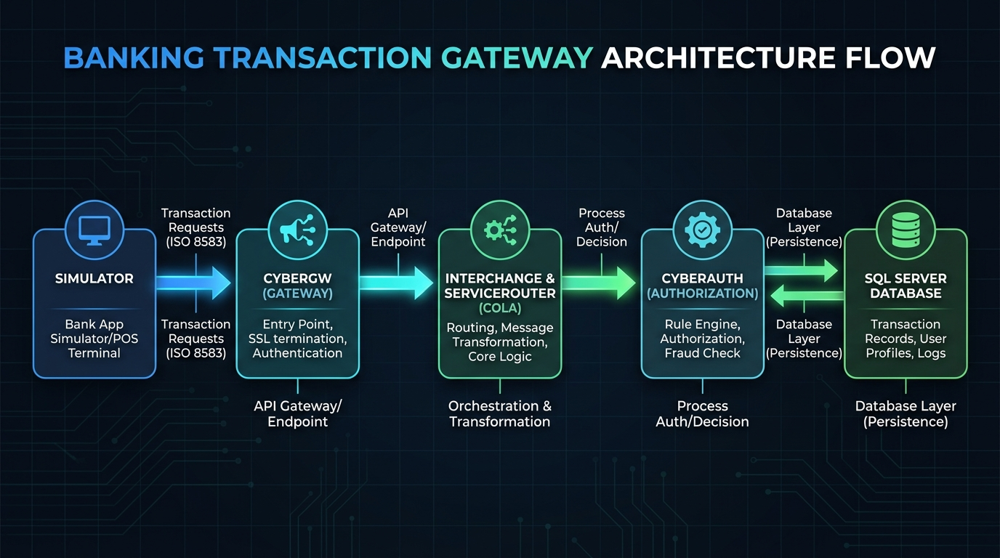
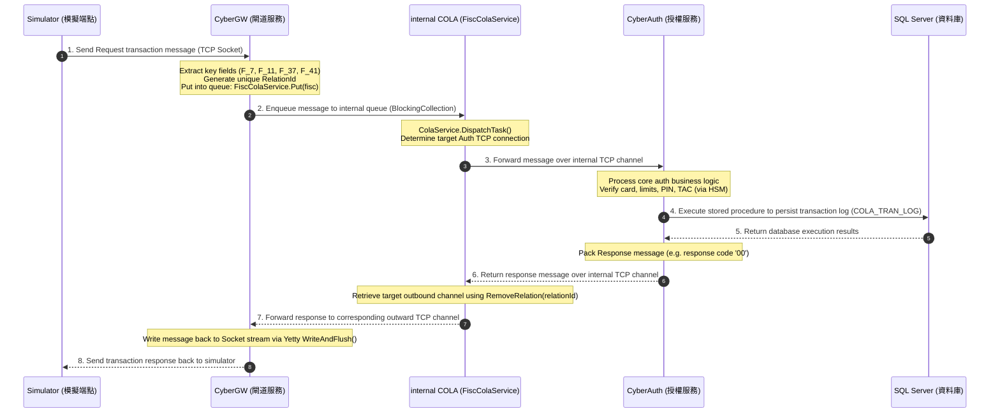

# CyberCOLA Transaction Flow & Network Architecture Documentation

This document describes the complete transaction life cycle and networking topology of the **CyberCOLA .NET 10** payment gateway system. It details the connection establishment handshakes, inbound message queues, internal routing, authorization logic, and SQL database logging.

---

## 1. System Architecture Overview

The system consists of five distinct tiers that process financial transactions bi-directionally:

```txt
  [Request Flow]
  Simulator ===(TCP/ISO)=======> CyberGW ===(BlockingQueue)===> internal COLA ===(Internal TCP)===> CyberAuth ===(SqlClient/SP)===> SQL Server (DB)

  [Response Flow]
  Simulator <---(TCP/ISO)------- CyberGW <---(RemoveRelation)--- internal COLA <---(Internal TCP)--- CyberAuth <---(SqlClient/SP)--- SQL Server (DB)
```

Below is the conceptual system architecture diagram showing the components in sequence:



---

## 2. Network Socket Connection Rules

Depending on the card networking standards and e-ticket protocols, CyberCOLA implements two distinct connection topologies at the Gateway (GW) tier:

### A. Active Connection Channels (GW = TCP Client)
*Applicable Channels: **FISC (財金)**, **NCCC (聯卡)***

- **Role**: The Gateway (`CyberGWFISC` or `CyberGWNCCC`) acts as a **TCP Client** and actively initiates connections to the external host/simulator (which acts as a **TCP Server** listening on target ports like `8100` / `8200` for FISC, or `14801` / `15801` for NCCC).
- **Session Handshake**: Once the TCP connection is established, the GW actively sends a financial **Sign-On Request** (e.g. `FISCTransCreator.FiscSignOnGWRequest()`). When the simulator responds with a successful **Sign-On Response**, the channel is marked as active and registered in the available pool of `FiscColaService` (internal COLA).

### B. Passive Connection Channels (GW = TCP Server)
*Applicable Channels: **ICASH (愛金卡)**, **IPASS (一卡通)**, **SVCS (智慧卡)***

- **Role**: The Gateway (`CyberGWICASH`, `CyberGWIPASS`, or `CyberGWSVCS`) acts as a **TCP Server** and opens local listening ports (e.g., Node 1 ports `6700`/`5504`/`4500`, Node 2 ports `15736`/`15836`/`15636`).
- **Session Handshake**: The external host/simulator acts as a **TCP Client** and actively initiates connections to the GW's listening port. Once accepted, the GW registers the `Yetty` channel and waits to process incoming transaction requests.

---

## 3. Step-by-Step Transaction Processing Sequence

The step-by-step transaction sequence is detailed below:



### 1. Inbound Transaction Capture (Simulator $\rightarrow$ GW)
- The simulator sends a request over the open TCP channel.
- The GW Inbound Handler (e.g., `FiscRegisterKeyHandler` for FISC) parses the raw ISO8583 or XML message.
- It extracts core matching fields (Transmission DateTime, System Trace Audit Number, Retrieval Reference Number, Terminal ID) and generates a unique **`RelationId`**.
- It calls `CyberGWFISCResource.FiscColaService.Put(fisc)` to enqueue the message to release network threads.

### 2. Internal Message Queuing & Routing (GW $\rightarrow$ internal COLA)
- The `ColaService` background worker (acting as the **`internal COLA`** layer) dequeues the message.
- It maps the `RelationId` and invokes `DispatchTask(item)` to write the packet to the active TCP channel connected to the backend `CyberAuth` service nodes.

### 3. Business Authorization Decider (internal COLA $\rightarrow$ Auth)
- The **`Auth`** service (e.g. `CyberAuthFISC` Node 1 or Node 2) receives the transaction.
- It performs core business checks: card status, transaction limit, available balance, and communicates with the HSM for PIN and TAC checks.

### 4. Database Persistence (Auth $\rightarrow$ SQL)
- The `Auth` service connects to the `SQL Server` database and executes a stored procedure to insert or update transaction records (such as `COLA_TRAN_LOG`).
- Once stored successfully, the database returns the query results back to the `Auth` service.

### 5. Response Return Chain (SQL $\rightarrow$ Auth $\rightarrow$ COLA $\rightarrow$ GW $\rightarrow$ Simulator)
- `Auth` packages the authorization response (e.g. `00` for Success) and sends it back to the internal COLA channel.
- `ColaService` matching the `RelationId` calls `RemoveRelation(relationId)` to retrieve the simulator's connection channel.
- The GW writes the response to the socket using `WriteAndFlush()` back to the simulator, completing the sequence.
